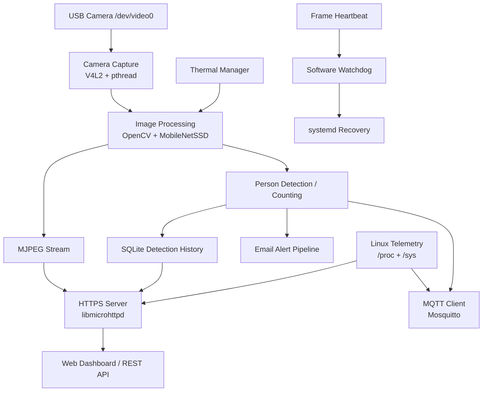

# Smart Guard

**Real-Time Embedded Monitoring & Security System**

Smart Guard is a Linux-based embedded monitoring and surveillance platform implemented primarily in C/C++. It integrates real-time camera capture, person detection, system telemetry, HTTPS services, MQTT messaging, persistent event logging, watchdog recovery, and adaptive thermal management.

The project was developed as an end-to-end embedded/Linux systems project with emphasis on hardware/software integration, reliability, security, observability, and reproducible testing.

---

## Features

- Real-time USB camera capture using V4L2
- MJPEG live video streaming
- OpenCV-based person detection using MobileNetSSD
- Real-time person counting
- CPU temperature, CPU usage, and memory telemetry
- HTTPS dashboard and REST endpoints
- Automatic HTTP-to-HTTPS redirection
- MQTT telemetry and event publishing
- Persistent SQLite detection history
- Guard / anti-theft monitoring mode
- Image and telemetry email alerts
- Software watchdog with frame-heartbeat monitoring
- Adaptive thermal throttling
- systemd-based service orchestration
- FastAPI / Swagger API layer
- Graceful SIGINT / SIGTERM shutdown
- Automated subsystem and integration tests

---

## Tech Stack

### Core
- C
- C++17
- POSIX / pthreads
- Linux

### Computer Vision
- V4L2
- OpenCV
- MobileNetSSD
- OpenCV DNN

### Networking and APIs
- libmicrohttpd
- HTTPS / TLS
- REST
- FastAPI
- Swagger
- JSON-C

### Messaging and Storage
- Mosquitto
- MQTT
- SQLite

### System Integration
- systemd
- OpenSSL
- Bash
- Python

---

## System Architecture



---

## Repository Structure

```text
.
├── api/                  # FastAPI / Swagger API
├── certs/                # TLS configuration templates
├── config/
│   ├── email/            # Example email configuration
│   ├── polkit/           # Controlled reboot permissions
│   └── systemd/          # systemd service definitions
├── docs/                 # Project documentation
├── image_processing/     # OpenCV / MobileNetSSD processing
├── include/              # C/C++ header files
├── mqtt/                 # MQTT client
├── scripts/              # Utility and certificate scripts
├── src/                  # Core Smart Guard implementation
├── tests/                # Automated validation tests
├── watchdog/             # Software watchdog
├── web/                  # Web dashboard
├── Makefile
└── README.md
```

---

## Core Components

### Camera Capture

The camera subsystem uses V4L2 to access a Linux-compatible USB camera and continuously acquire frames for streaming and image processing.

The processing pipeline is designed around a `/dev/video*` camera device and supports real-time frame acquisition.

### Person Detection

Frames are processed using OpenCV DNN and a MobileNetSSD object-detection model.

The detector identifies people in the camera stream and exposes the current person count to other Smart Guard subsystems.

### Telemetry

Smart Guard collects Linux system telemetry including:

- CPU temperature
- CPU utilization
- available memory

Telemetry data is exposed through the HTTPS interface and can also be published through MQTT.

### Persistent Detection History

Detection events are stored using SQLite.

This allows event history to persist across application and service restarts.

### HTTPS Server

The native C web server is implemented using `libmicrohttpd`.

It provides:

- the web dashboard
- telemetry endpoints
- detection history
- MJPEG video streaming
- guard-mode functionality

Plain HTTP requests can be redirected to HTTPS.

### FastAPI / Swagger Layer

A separate Python API component provides an additional FastAPI interface and interactive Swagger documentation.

Source:

```text
api/swagger_app.py
```

### MQTT

A dedicated MQTT component publishes Smart Guard information through a Mosquitto broker.

Generic topic structure:

```text
telemetry/<device-id>/home
persons/<device-id>/home
status/<device-id>/home
```

Deployment-specific broker credentials are supplied externally and are not stored in the source code.

### Guard Mode

Guard mode provides anti-theft / monitoring behavior and persistent guard-state handling.

### Email Alerts

The email-alert subsystem can send detection notifications containing runtime telemetry and captured image data.

SMTP credentials are supplied through external environment configuration and are not committed to the repository.

### Thermal Management

Smart Guard monitors Linux thermal sensors and can dynamically reduce image-processing load when processor temperature becomes high.

This provides a simple adaptive thermal-throttling mechanism for long-running embedded workloads.

### Frame-Heartbeat Watchdog

The main processing pipeline produces a frame heartbeat.

A separate watchdog monitors heartbeat freshness and can trigger service recovery if frame production stalls.

This makes it possible to detect a failure even when the main process itself has not terminated.

---

## Dependencies

On Ubuntu/Debian systems, the core dependencies can be installed with:

```bash
sudo apt update

sudo apt install \
    build-essential \
    pkg-config \
    libmicrohttpd-dev \
    libjson-c-dev \
    libmosquitto-dev \
    mosquitto \
    mosquitto-clients \
    libcurl4-openssl-dev \
    libsqlite3-dev \
    libopencv-dev \
    openssl \
    python3 \
    python3-venv
```

---

## Build

Clone the repository and build the native components:

```bash
git clone <repository-url>
cd smart-guard
make
```

Generated binaries are placed under:

```text
bin/
```

Build products are intentionally excluded from version control.

---

## MobileNetSSD Model

Smart Guard uses MobileNetSSD through OpenCV DNN.

The model weights are intentionally not included in this repository.

Expected files:

```text
image_processing/models/MobileNetSSD_deploy.prototxt
image_processing/models/MobileNetSSD_deploy.caffemodel
```

The repository includes the model definition file and setup information under:

```text
image_processing/models/
```

The `.caffemodel` weight file must be obtained separately before running person detection.

---

## TLS / HTTPS Setup

Production TLS private keys are intentionally excluded from the repository.

The repository provides:

```text
certs/openssl_lan.cnf
scripts/update_lan_certificate.sh
```

for local certificate configuration.

The deployment layout expects certificate files similar to:

```text
/opt/smart-guard/certs/server.crt
/opt/smart-guard/certs/server.key
```

Never commit production private keys to source control.

---

## Runtime Configuration

Deployment-specific credentials and runtime settings are loaded from external environment files.

Typical configuration location:

```text
/etc/smart-guard/
```

Example runtime files include:

```text
email.env
mqtt.env
thermal.env
watchdog.env
```

The repository only contains safe configuration examples such as:

```text
config/email/email.env.example
```

Production passwords and secrets must not be stored in the repository.

---

## Example Email Configuration

```text
EMAIL_ENABLED=0
EMAIL_SMTP_URL=smtp://smtp.example.com:587
EMAIL_USERNAME=sender@example.com
EMAIL_PASSWORD=application-password
EMAIL_FROM=sender@example.com
EMAIL_TO=receiver@example.com
```

Use real credentials only in the deployment environment.

---

## Development HTTPS Endpoint

A typical local HTTPS endpoint is:

```text
https://127.0.0.1:8443/
```

The exact address and network configuration depend on the deployment environment.

---

## systemd Deployment

Service definitions are provided under:

```text
config/systemd/
```

The public deployment layout assumes the application is installed under:

```text
/opt/smart-guard/
```

The main application is designed to run using a dedicated:

```text
smartguard
```

system account.

Several services apply systemd hardening directives such as:

```text
NoNewPrivileges=true
PrivateTmp=true
ProtectKernelTunables=true
ProtectKernelModules=true
ProtectControlGroups=true
RestrictSUIDSGID=true
LockPersonality=true
```

---

## Security Design

Smart Guard includes several security-oriented design choices:

- HTTPS/TLS transport
- externalized credentials
- authenticated MQTT deployment support
- no production credentials stored in source code
- private TLS keys excluded from version control
- systemd service hardening
- dedicated application account
- controlled reboot permissions
- automatic service supervision
- watchdog-based recovery
- HTTP-to-HTTPS redirection

Additional information is available in:

```text
docs/security.md
```

---

## Testing

Smart Guard includes automated and semi-automated tests under:

```text
tests/
```

The test suite covers multiple subsystems, including:

- telemetry
- HTTPS behavior
- REST endpoints
- MJPEG streaming
- image processing
- camera behavior
- MQTT communication
- thermal-management behavior
- watchdog and recovery behavior
- end-to-end integration

Some tests require hardware or runtime infrastructure such as:

- a V4L2-compatible camera
- active Smart Guard services
- a Mosquitto broker
- TLS certificates
- MobileNetSSD model weights

See:

```text
docs/testing.md
```

for additional details.

---

## Reliability

Smart Guard combines several reliability mechanisms:

1. systemd process supervision
2. frame-heartbeat monitoring
3. software watchdog recovery
4. persistent SQLite event logging
5. adaptive thermal management
6. graceful signal handling

The system handles `SIGINT` and `SIGTERM` to perform controlled shutdown of active subsystems.

---

## Documentation

Additional project documentation is available under:

```text
docs/
```

including:

- architecture overview
- security design
- testing and validation

---

## Development Platform

The project was developed and validated on Ubuntu Linux.

The software architecture relies primarily on standard Linux interfaces and open-source libraries, making it suitable for adaptation to Linux-based embedded SBC platforms.

---

## Notes

Generated binaries, local databases, virtual environments, private keys, runtime credentials, backup files, and third-party model weights are intentionally excluded from this repository.

---

## Author

**Saina Kashani**

B.Sc. Electrical Engineering  
Sharif University of Technology

---
---

## Load Test Results

The HTTPS telemetry API was stress-tested using repeated rounds of concurrent requests.

- Concurrent requests per round: **50**
- Load duration: **30 seconds**
- Total requests completed: **4,250**
- Successful HTTP 200 responses: **4,250 / 4,250**
- Measured throughput: **141.177 requests/second**

The corresponding test implementation is available in:

`tests/section2/run_test_2_3.sh`

and the recorded results are available under:

`docs/results/`
